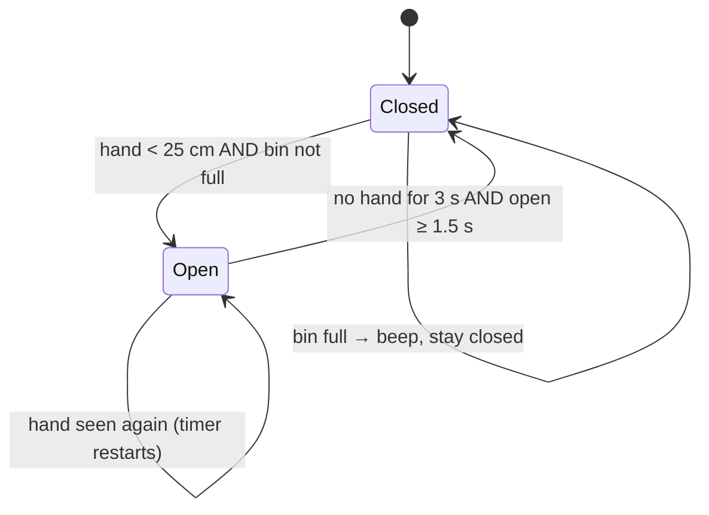

# Smart Bin: Touchless Rubbish Bin with Fill-Level Monitoring

[](https://github.com/Haytamzerr/smart-bin/actions/workflows/build.yml)

An Arduino bin that **opens by itself** when you bring your hand close, **closes** a few seconds later, and **knows how full it is**. Green, yellow and red LEDs show the level, and once it is full the lid stays shut and a buzzer warns whoever tries to use it.

No touching a dirty lid, and no overflowing bins: useful in kitchens, hospitals, schools and public spaces.

## Features

- **Touchless opening**: an ultrasonic sensor detects a hand within 25 cm and a servo lifts the lid
- **Smart closing**: the lid stays open while you keep throwing things in, then closes 3 s after your hand leaves (never sooner than 1.5 s after opening)
- **Fill level**: a second ultrasonic sensor under the lid measures the rubbish height → 0–100 %
- **LED gauge**: green (low), green + yellow (medium), yellow + red (high), red (full)
- **Full-bin lock**: a full bin refuses to open and beeps, so it can't overflow
- **Noise filtering**: a median of the last 5 readings ignores the false echoes HC-SR04 sensors sometimes return
- **Non-blocking firmware**: no `delay()` in the loop, so the bin keeps measuring while the lid moves
- **Serial logging**: CSV every 2 s (`time_ms,front_cm,fill_pct,level,lid,opens`), ready to plot or send to a dashboard

## How it works



**Distance**: the HC-SR04 sends an ultrasonic pulse and times the echo: `distance = time × 343 m/s ÷ 2` (there and back). `pulseIn` has a 25 ms timeout, so an empty space in front doesn't freeze the program for a second.

**Fill level**: the inside sensor looks down. At 40 cm (the bottom) the bin is empty, at 8 cm it's full, and the percentage is linear in between. The levels switch at 50 / 80 / 95 % going up and 5 % lower going down (**hysteresis**), so the LED doesn't flicker when the rubbish sits right on a threshold.

## Hardware

| Part | Qty |
|---|---|
| Arduino Uno (or Nano) | 1 |
| HC-SR04 ultrasonic sensor | 2 |
| SG90 servo motor | 1 |
| LEDs: green, yellow, red + 220 Ω resistors | 3 |
| Active or passive buzzer | 1 |
| Bin with a hinged lid, jumper wires, 5 V supply | |

### Wiring

| Component | Pin | Arduino |
|---|---|---|
| Front HC-SR04 (hand) | TRIG / ECHO | D9 / D8 |
| Inside HC-SR04 (fill level) | TRIG / ECHO | D11 / D10 |
| Servo (lid) | signal | D6 |
| Green / yellow / red LED (via 220 Ω) | anode | D3 / D4 / D5 |
| Buzzer | + | D7 |
| Sensors and servo | VCC / GND | 5V / GND |

> The servo can draw more current than the USB port gives when it starts. If the board resets when the lid moves, power the servo from a separate 5 V supply (with a common GND).

## Try it without hardware (Wokwi simulator)

1. Open <https://wokwi.com/projects/new/arduino-uno>
2. Replace `sketch.ino` with [`smart_bin/smart_bin.ino`](smart_bin/smart_bin.ino)
3. Add a new file `bin_logic.h` with [`smart_bin/bin_logic.h`](smart_bin/bin_logic.h)
4. Replace `diagram.json` with [`smart_bin/diagram.json`](smart_bin/diagram.json), then press ▶
5. Click the **front** sensor and drag its distance under 25 cm: the lid opens, then closes 3 s after you move it back. Drag the **inside** sensor towards 8 cm: the LEDs go green → yellow → red, and the lid stops opening.

## Upload to a real board

Open `smart_bin/smart_bin.ino` in the Arduino IDE (it opens `bin_logic.h` with it), select **Arduino Uno** and the port, then click **Upload**. Open the Serial Monitor at 9600 baud to see the logs.

Adjust the settings at the top of the sketch to your bin: `HAND_CM`, `HOLD_MS`, `BIN_EMPTY_CM`, `BIN_FULL_CM`, and the servo angles `LID_OPEN_ANGLE` / `LID_CLOSED_ANGLE`.

## Tests

The decision logic (median filter, lid state machine, fill gauge) lives in `bin_logic.h` with no Arduino function inside, so it runs on a PC:

```bash
g++ -std=c++11 -I smart_bin test/test_bin_logic.cpp -o test_bin_logic && ./test_bin_logic
# 35 checks, 0 failed
```

The tests cover:
- a false 400 cm echo ignored by the filter;
- the lid closing exactly 3 s after the hand leaves, and staying open while you keep using it;
- someone walking past at 60 cm not opening it;
- a full bin staying closed;
- the hysteresis;
- the `millis()` overflow after 49 days.

GitHub Actions runs these tests and also **compiles the sketch for the Arduino Uno** on every push.

## Project structure

```
smart_bin/
  smart_bin.ino    pins, settings, sensors, servo, LEDs, buzzer, serial log
  bin_logic.h      median filter, lid state machine, fill gauge (pure C++)
  diagram.json     circuit for the Wokwi simulator
test/
  test_bin_logic.cpp
```

## Authors

- **Haytam Zerrouki**
- **Hamza Bouafi**

It started with a single sensor and a servo (open when a hand is near). This version adds fill-level monitoring, the full-bin lock, filtering, non-blocking timing and tests.

## Ideas for next steps
- ESP32 + Wi-Fi: send the fill level to a web dashboard, or alert the cleaning team when a bin is full
- Sort waste by type (an inductive sensor for metal, a moisture sensor for organic waste)
- Battery power with deep sleep between measurements
